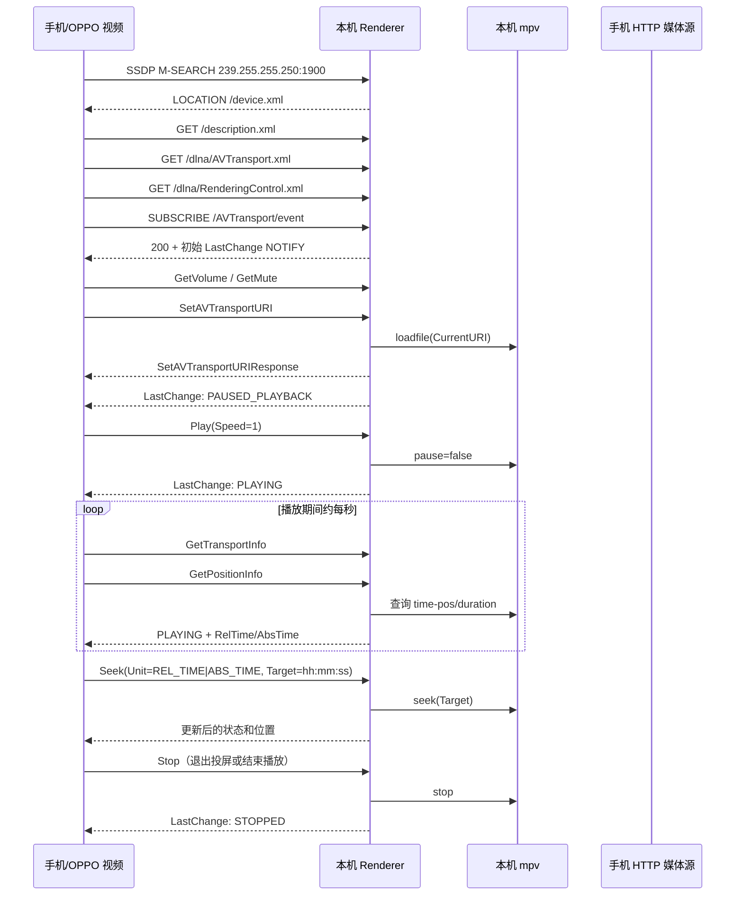

# OPPO 视频投屏的 DLNA 交互记录

本文记录在局域网中使用 OPPO 视频作为控制端、Windows 本机作为 DLNA
MediaRenderer 时观察到的一次完整投屏会话。Macast 是可用的参考实现，
`tools/mock_dlna_renderer.py` 是本项目的测试接收端。

文档中的地址均为示例。实测时手机地址是 `192.168.1.107`，本机地址是
`192.168.1.101`；手机提供视频的 HTTP 端口和本机接收端口会变化。

## 参与者和数据方向

| 角色 | 作用 | 示例 |
| --- | --- | --- |
| 控制端（手机） | 发现设备、发送 SOAP 控制、接收 GENA 状态事件 | OPPO 视频 |
| 接收端（本机） | 提供 UPnP MediaRenderer、控制 mpv、回报播放状态 | Macast 或 Mock Renderer |
| 媒体源（手机） | 通过 HTTP 提供视频字节流 | `http://<phone-ip>:<port>/content%3A%2F%2F...` |

DLNA 控制请求和媒体传输是两条链路。手机把视频 URL 放在
`SetAVTransportURI` 中，本机的 mpv 随后直接向该 URL 发起 HTTP 请求；
本次日志记录了前者的 SSDP、HTTP、SOAP 和 GENA 控制面，没有抓取 mpv
内部的完整媒体字节流。

## 一次成功会话的时序



## 具体交互

### 1. SSDP 发现

手机向 `239.255.255.250:1900` 发送一个或多个 `M-SEARCH`，常见目标包括：

- `upnp:rootdevice`
- `urn:schemas-upnp-org:device:MediaRenderer:1`

接收端返回 `200 OK`，至少包含：

```text
LOCATION: http://<renderer-ip>:<renderer-port>/device.xml
ST: urn:schemas-upnp-org:device:MediaRenderer:1
USN: uuid:<renderer-id>::urn:schemas-upnp-org:device:MediaRenderer:1
```

同一局域网里同时运行 Macast 和 Mock Renderer 时，手机会显示两个设备；
这是两个不同的 SSDP 广播源，不代表一次会话建立了两条连接。

### 2. 设备描述和 SCPD

手机先读取设备描述，再读取服务控制协议描述（SCPD）。成功参考实现使用
以下服务 URL：

```text
GET /description.xml
GET /dlna/AVTransport.xml
GET /dlna/RenderingControl.xml
GET /dlna/ConnectionManager.xml
```

设备描述中的三个服务使用相对路径：

```xml
<SCPDURL>dlna/AVTransport.xml</SCPDURL>
<controlURL>AVTransport/action</controlURL>
<eventSubURL>AVTransport/event</eventSubURL>
```

AVTransport 的 SCPD 需要声明完整动作和状态变量。实际使用中尤其不能省略
`GetMediaInfo`、`GetDeviceCapabilities`、`GetCurrentTransportActions`、
`LastChange`、`CurrentMediaDuration`、`CurrentTrackDuration`、
`CurrentTrack` 和 `NumberOfTracks`。OPPO 视频会根据 SCPD 选择后续控制分支，
因此“能够返回一个 SOAP 200”不足以证明描述文件兼容。

### 3. GENA 事件订阅

手机订阅 AVTransport 事件，典型请求头为：

```text
CALLBACK: <http://<phone-ip>:<phone-port>/evetSub>
NT: upnp:event
Timeout: infinite
```

`Timeout: infinite` 必须被接收端接受；不能只按 `Second-数字` 解析，否则会
返回 500，手机可能仍能继续控制，但无法获得可靠的状态同步。

接收端返回 `SID` 和 `TIMEOUT`，随后向回调地址发送 `NOTIFY`。Macast 使用
`LastChange`，内容至少包含：

```xml
<Event xmlns="urn:schemas-upnp-org:metadata-1-0/AVT/">
  <InstanceID val="0">
    <TransportState val="PAUSED_PLAYBACK"/>
    <TransportStatus val="OK"/>
    <CurrentTrack val="1"/>
    <NumberOfTracks val="1"/>
    <CurrentTrackDuration val="00:03:55"/>
    <CurrentMediaDuration val="00:03:55"/>
  </InstanceID>
</Event>
```

实际时长由 mpv 探测，初始阶段可能为空；字段本身仍应存在。每次状态改变
后递增 `SEQ`，并保持同一个 `SID`。

### 4. SOAP 控制顺序

成功投屏的核心顺序是：

1. `RenderingControl:GetVolume`
2. `RenderingControl:GetMute`
3. `AVTransport:SetAVTransportURI`
4. `AVTransport:Play`，参数 `Speed=1`
5. 交替轮询 `GetTransportInfo` 和 `GetPositionInfo`
6. 用户拖动进度时发送 `Seek`
7. 退出或停止时发送 `Stop`

`SetAVTransportURI` 中的关键数据来自手机自己的媒体 HTTP 服务。例如：

```xml
<CurrentURI>
  http://<phone-ip>:<phone-port>/content%3A%2F%2Fmedia%2Fexternal%2Fvideo%2Fmedia%2F1000056432
</CurrentURI>
<CurrentURIMetaData>
  &lt;DIDL-Lite ...&gt;
    &lt;item id="..." parentID="1" restricted="0"&gt;
      &lt;dc:title&gt;DLNA-Video&lt;/dc:title&gt;
      &lt;upnp:class&gt;object.item.videoItem&lt;/upnp:class&gt;
      &lt;res protocolInfo="http-get:*:video/mp4:*;DLNA.ORG_OP=01;"&gt;
        http://<phone-ip>:<phone-port>/content%3A%2F%2F...
      &lt;/res&gt;
    &lt;/item&gt;
  &lt;/DIDL-Lite&gt;
</CurrentURIMetaData>
```

接收端应保存原始 URI 和元数据，并在 `GetPositionInfo` 中原样返回
`TrackURI`、`TrackMetaData`。Macast 观察到的初始位置格式为：

```xml
<Track>0</Track>
<RelTime>00:00:00</RelTime>
<AbsTime>00:00:00</AbsTime>
<RelCount>2147483647</RelCount>
<AbsCount>2147483647</AbsCount>
```

### 5. 状态握手和进度

Macast 的源码在 `SetAVTransportURI` 中加载并恢复播放器、设置初始
`PAUSED_PLAYBACK`，也会通过 mpv 的 `pause` 和 `playback-restart` 事件更新
真实状态。因此“必须收到手机的 `Play` 才能报告 `PLAYING`”不是有效假设。

此前源码版 Macast 追踪中的 `SetAVTransportURI → Play` 序列不能作为完整
成功基准：`tools/macast-trace-data/trace.log` 在 2026-10-13 23:35:16 同时
记录了 IPC 拒绝访问及 `NoneType.send_bytes` 错误，`macast.log` 还记录了
订阅 HTTP 500。该轮播放器并未正常连接。官方 Windows Macast 的人工实测
成功仍成立，但不能与这份源码版日志混为一谈。

Mock Renderer 采用了 Macast 的完整描述和相同的 `/dlna/...` 路径，但这并不
等价于实现了 Macast 的完整播放器状态机。修复 SOAP 响应的编码属性后，
2026-10-14 的网络复测已经确认 OPPO 视频可以保持投屏、持续播放、Seek，
末尾则转入停止状态，但伴有音频输出错误，不能据此确认正常 EOF。Mock 日志
同时记录了 `SetAVTransportURI`、`GetPositionInfo`、`Seek` 和播放器事件。
官方 Windows Macast v0.7 仍可作为对照接收端，用于后续比较更细的 GENA 和
SOAP 行为。

后续修复应以官方 Macast 的实际日志和响应为基准，逐项比较以下内容：

- `SetAVTransportURI` 返回前后 mpv 的加载、暂停和播放事件顺序；
- `LastChange` 的完整 XML、`SEQ` 增长和发送时机；
- `GetPositionInfo` 中的 `Track`、时长、元数据和媒体 URI；
- `GetTransportInfo` 与 GENA `TransportState` 是否始终一致；
- 播放结束、Stop 和换 URI 时是否清理旧的订阅和播放器状态。

官方 Macast 可继续作为对照接收端；当前 Mock 已通过本轮持续播放及 Seek 测试。
正常 EOF、中途断开及换视频仍需在当前修复版本上分别复测。

### 2026-10-14 18:43 的隔离复测

启用完整访问后，仅运行一个 Mock，mpv 启动和 IPC 成功。原始记录保存在
本机忽略文件 `tools/mock-trace-20261014-184222.ndjson` 中：

- 18:43:52，`SetAVTransportURI` 响应耗时约 60 ms，GENA SEQ 2 报告暂停，
  手机对 NOTIFY 返回 HTTP 200。
- 18:43:53，mpv 已发出 `playback-restart`，视频位置持续增长；但
  `_awaiting_play=True` 抑制了播放器状态回调。
- 手机后续 `GetTransportInfo` 全部获得 `PAUSED_PLAYBACK`，该轮没有 `Play`，
  约 5 秒后有一次 `Seek`。用户确认手机退出投屏，而电脑视频继续播放。
- 18:44:01 的 mpv 暂停是用户在测试结束后手动操作，不能当作退出的原因。

该日志确认了播放器与对外协议状态不同步。修复移除了对 SOAP `Play` 的
无限等待，以活动媒体的 mpv 事件同步状态，并在新 URI 加载时解除上一个视频
遗留的暂停。三个回归检查覆盖无 `Play` 时的状态上报、本机暂停/恢复，以及
播放结束后的空闲事件。当时尚未完成手机端验证；随后 19:39 的复测已确认
手机可以保持会话，但不能证明状态不同步是所有历史失败的唯一原因。

## 调试和复现

启动本机模拟器：

```powershell
cd D:\data\desktop\materials\repos\cloudmusic2ktv\url_display_dlna
python .\tools\mock_dlna_renderer.py --advertise-ip 192.168.1.101 --port 8765
```

读取状态：

```powershell
Invoke-WebRequest -UseBasicParsing http://192.168.1.101:8765/state |
  Select-Object -ExpandProperty Content
```

Macast 源码追踪器会把日志写入 `tools/macast-trace-data/trace.log`；该目录已
加入忽略规则。追踪时应一次只运行一个占用 UDP 1900 的 Renderer，避免手机
把两个设备的请求混在一起。

## 当前结论和边界

- 已确认纯 K 屏幕使用的是标准 DLNA MediaRenderer 控制链路，至少 OPPO 视频
  的这条投屏路径不需要私有 SOAP 协议。
- 已确认手机 HTTP 媒体地址必须能被本机直接访问；手机和本机要在同一局域网，
  并允许手机提供媒体服务的端口通过防火墙。
- 当前记录覆盖控制面。若要分析卡顿、HTTP Range、断点续传或编码兼容性，
  还需要单独抓取本机到手机媒体 URL 的 HTTP 请求和响应。

### 2026-10-14 19:39 的网络成功复测

修复 SOAP 响应中的 `s:encodingStyle="http://schemas.xmlsoap.org/soap/encoding/"`
后，使用 OPPO 视频在同一局域网再次完整投屏。手机为 `192.168.1.106`，
本机为 `192.168.1.107`，原始记录保存在
`captures/soap-fixed-network-20261014-193911/`（该目录默认忽略）。

本轮确认的表现：

- 选择 `CloudMusic2KTV Mock Renderer` 后，手机长期保持投屏中的播放界面；
- 手机状态显示 `PLAYING`，进度持续增长；
- 连续执行 5 次 Seek，手机进度条和 mpv 播放位置均正确更新；
- 手机持续发送 `GetTransportInfo` 与 `GetPositionInfo`；
- 最终位置为 235.1 秒，时长为 235.138 秒，Mock 状态变为 `STOPPED`。

本轮控制请求统计为：`SetAVTransportURI` 1 次、`Play` 1 次、`Seek` 5 次、
`Stop` 2 次。统计来自 `tools/mock-trace-20261014-191047.ndjson` 中
UTC 11:39:11 之后的服务端记录；该范围内 `GetTransportInfo` 为 213 次，
`GetPositionInfo` 为 208 次。手机日志中的 SOAP 结果已从 `res:-1` 变为
`res:0`，本轮没有复现几秒后退出，但不能将所有历史失败归于单一原因。

末尾 mpv 的 `end-file` 报告 `reason=error`，错误为
`audio output initialization failed`，因此尚不能把这轮归类为正常 EOF 验证。
该错误与本机没有可用音频输出设备有关；连接耳机时已有实测声音输出，不属于
DLNA 控制链路故障。此前失败轮的 Wi-Fi 切换发生在退出之后，不能据此解释退出。

本轮之后已补上 GENA 订阅管理：服务端会尊重并续订 `TIMEOUT`，到期自动移除；
同一 SID 的续订会刷新租约；相同回调地址的重复订阅会替换旧 SID；通知连续失败
三次或收到 HTTP 412 时会删除失效订阅。每个订阅使用独立的通知队列和 `SEQ`，
避免并发通知乱序。这样旧手机端口只会在最多三次失败通知后被清理，不会长期占用
状态或影响新的投屏会话。

`tools/test_mpv_state.py` 的 4 项回归检查通过，其中新增了订阅替换和过期清理检查。
原始抓包已导出为同一 capture
目录下的 `http-packets.txt`；该脚本仅提取 1900/8765 端口的单包负载，不做 TCP
流重组，也不能单凭其输出判定重传或证明 GENA 与媒体传输被完整捕获。

### 2026-10-14 的完整 OPPO 视频操作复测

用户使用 OPPO 视频连续执行了多种日常操作，服务端 trace 为
`tools/mock-trace-20261014-subscription-cleanup.ndjson`。记录显示：

- 4 次 `SetAVTransportURI`，对应 3 个不同视频 URI（其中一个重复投屏）；
- 5 次 `Play`、2 次 `Pause`、7 次 `Seek`；
- `GetTransportInfo` 和 `GetPositionInfo` 各 181 次；
- 所有 406 个 SOAP HTTP 响应均为 200，最大服务端响应耗时约 120 ms；
- mpv 结束事件为 1 次 `eof`、1 次 `stop` 和 2 次 `quit`；
- 手机 GENA 通知 33 次全部返回 HTTP 200，`SEQ` 从 0 连续增长到 32；
  另有 1 次本机订阅自测通知，同样返回 200；
- 手机在停止时会重复发送多次 `Stop`，Mock 均正确返回成功，未造成状态错误。

本轮 trace 没有收到 `UNSUBSCRIBE`。确认 ADB 已断开时，状态中仍保留 1 个
AVTransport 订阅，剩余租约约 23 分钟；没有新通知时由租约到期清理。
再次订阅同一服务和回调地址会替换旧 SID；新回调地址则独立建订阅，旧地址
按连续失败或到期规则清理。USB 断开本身不等于 Wi-Fi 或 GENA 订阅立即断开。

本轮没有新建原始抓包目录，检查时 ADB 已离线且没有运行中的 logcat 采集进程。
上述判断来自 Mock HTTP/GENA/mpv trace 和用户操作反馈，不能替代完整的网络包
或手机内部日志分析。本轮没有发现需要继续修补的错误，模拟器保持运行。
