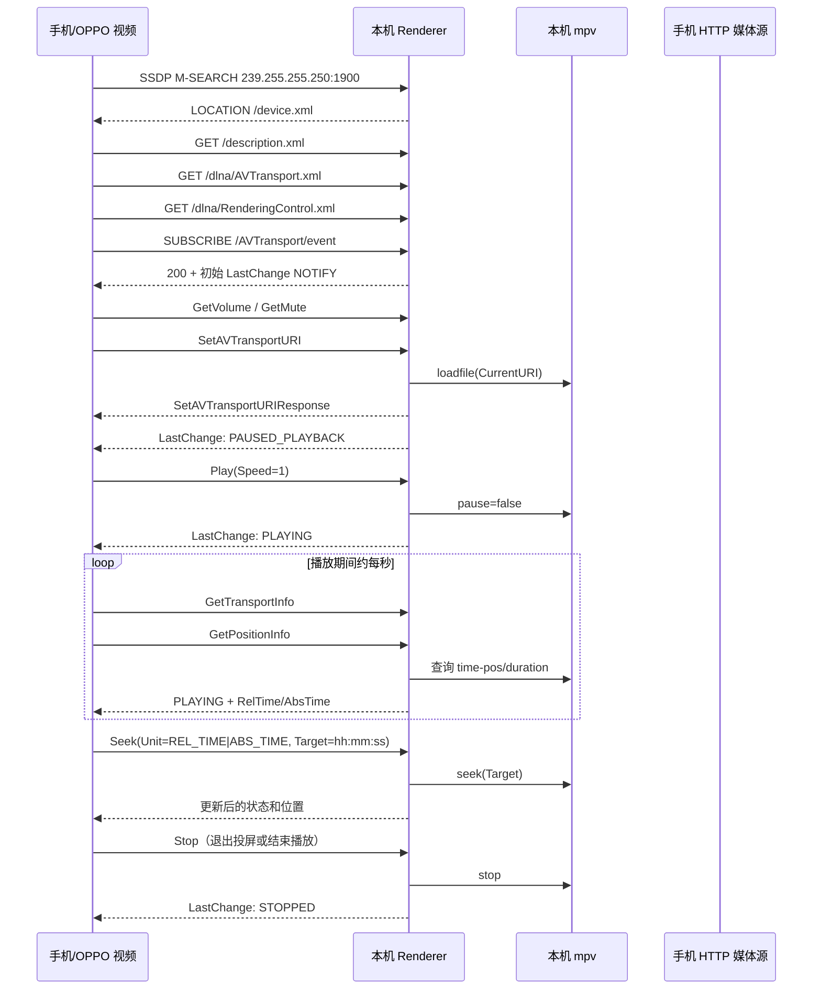

# OPPO 视频投屏的 DLNA 交互记录

本文记录在局域网中使用 OPPO 视频作为控制端、Windows 本机作为 DLNA
MediaRenderer 时观察到的一次完整投屏会话。Macast 是可用的参考实现，
`tools/mock_dlna_renderer.py` 是本项目的测试接收端。

文档中的地址均为示例。实测时手机地址是 `192.168.1.107`，本机地址是
`192.168.1.101`；手机提供视频的 HTTP 端口和本机接收端口会变化。

## 参与者和数据方向

| 角色 | 作用 | 示例 |
| --- | --- | --- |
| 控制端（手机） | 发现设备、发送 SOAP 控制、接收 GENA 状态事件 | OPPO 视频 |
| 接收端（本机） | 提供 UPnP MediaRenderer、控制 mpv、回报播放状态 | Macast 或 Mock Renderer |
| 媒体源（手机） | 通过 HTTP 提供视频字节流 | `http://<phone-ip>:<port>/content%3A%2F%2F...` |

DLNA 控制请求和媒体传输是两条链路。手机把视频 URL 放在
`SetAVTransportURI` 中，本机的 mpv 随后直接向该 URL 发起 HTTP 请求；
本次日志记录了前者的 SSDP、HTTP、SOAP 和 GENA 控制面，没有抓取 mpv
内部的完整媒体字节流。

## 一次成功会话的时序



## 具体交互

### 1. SSDP 发现

手机向 `239.255.255.250:1900` 发送一个或多个 `M-SEARCH`，常见目标包括：

- `upnp:rootdevice`
- `urn:schemas-upnp-org:device:MediaRenderer:1`

接收端返回 `200 OK`，至少包含：

```text
LOCATION: http://<renderer-ip>:<renderer-port>/device.xml
ST: urn:schemas-upnp-org:device:MediaRenderer:1
USN: uuid:<renderer-id>::urn:schemas-upnp-org:device:MediaRenderer:1
```

同一局域网里同时运行 Macast 和 Mock Renderer 时，手机会显示两个设备；
这是两个不同的 SSDP 广播源，不代表一次会话建立了两条连接。

### 2. 设备描述和 SCPD

手机先读取设备描述，再读取服务控制协议描述（SCPD）。成功参考实现使用
以下服务 URL：

```text
GET /description.xml
GET /dlna/AVTransport.xml
GET /dlna/RenderingControl.xml
GET /dlna/ConnectionManager.xml
```

设备描述中的三个服务使用相对路径：

```xml
<SCPDURL>dlna/AVTransport.xml</SCPDURL>
<controlURL>AVTransport/action</controlURL>
<eventSubURL>AVTransport/event</eventSubURL>
```

AVTransport 的 SCPD 需要声明完整动作和状态变量。实际使用中尤其不能省略
`GetMediaInfo`、`GetDeviceCapabilities`、`GetCurrentTransportActions`、
`LastChange`、`CurrentMediaDuration`、`CurrentTrackDuration`、
`CurrentTrack` 和 `NumberOfTracks`。OPPO 视频会根据 SCPD 选择后续控制分支，
因此“能够返回一个 SOAP 200”不足以证明描述文件兼容。

### 3. GENA 事件订阅

手机订阅 AVTransport 事件，典型请求头为：

```text
CALLBACK: <http://<phone-ip>:<phone-port>/evetSub>
NT: upnp:event
Timeout: infinite
```

`Timeout: infinite` 必须被接收端接受；不能只按 `Second-数字` 解析，否则会
返回 500，手机可能仍能继续控制，但无法获得可靠的状态同步。

接收端返回 `SID` 和 `TIMEOUT`，随后向回调地址发送 `NOTIFY`。Macast 使用
`LastChange`，内容至少包含：

```xml
<Event xmlns="urn:schemas-upnp-org:metadata-1-0/AVT/">
  <InstanceID val="0">
    <TransportState val="PAUSED_PLAYBACK"/>
    <TransportStatus val="OK"/>
    <CurrentTrack val="1"/>
    <NumberOfTracks val="1"/>
    <CurrentTrackDuration val="00:03:55"/>
    <CurrentMediaDuration val="00:03:55"/>
  </InstanceID>
</Event>
```

实际时长由 mpv 探测，初始阶段可能为空；字段本身仍应存在。每次状态改变
后递增 `SEQ`，并保持同一个 `SID`。

### 4. SOAP 控制顺序

成功投屏的核心顺序是：

1. `RenderingControl:GetVolume`
2. `RenderingControl:GetMute`
3. `AVTransport:SetAVTransportURI`
4. `AVTransport:Play`，参数 `Speed=1`
5. 交替轮询 `GetTransportInfo` 和 `GetPositionInfo`
6. 用户拖动进度时发送 `Seek`
7. 退出或停止时发送 `Stop`

`SetAVTransportURI` 中的关键数据来自手机自己的媒体 HTTP 服务。例如：

```xml
<CurrentURI>
  http://<phone-ip>:<phone-port>/content%3A%2F%2Fmedia%2Fexternal%2Fvideo%2Fmedia%2F1000056432
</CurrentURI>
<CurrentURIMetaData>
  &lt;DIDL-Lite ...&gt;
    &lt;item id="..." parentID="1" restricted="0"&gt;
      &lt;dc:title&gt;DLNA-Video&lt;/dc:title&gt;
      &lt;upnp:class&gt;object.item.videoItem&lt;/upnp:class&gt;
      &lt;res protocolInfo="http-get:*:video/mp4:*;DLNA.ORG_OP=01;"&gt;
        http://<phone-ip>:<phone-port>/content%3A%2F%2F...
      &lt;/res&gt;
    &lt;/item&gt;
  &lt;/DIDL-Lite&gt;
</CurrentURIMetaData>
```

接收端应保存原始 URI 和元数据，并在 `GetPositionInfo` 中原样返回
`TrackURI`、`TrackMetaData`。Macast 观察到的初始位置格式为：

```xml
<Track>0</Track>
<RelTime>00:00:00</RelTime>
<AbsTime>00:00:00</AbsTime>
<RelCount>2147483647</RelCount>
<AbsCount>2147483647</AbsCount>
```

### 5. 状态握手和进度

Macast 的关键行为是：收到 `SetAVTransportURI` 后立即让播放器加载 URI，
但先对手机报告 `PAUSED_PLAYBACK`；收到 `Play` 后才报告 `PLAYING`。这两个
动作的先后同时影响手机界面和播放器状态。

旧版 Mock Renderer 在 `SetAVTransportURI` 后报告 `TRANSITIONING/PLAYING`，
且 LastChange 只有 `TransportState` 和 `TransportStatus`。OPPO 视频因此不
发送 `Play`，而进入反复 `Seek` 的分支，手机几秒后退出投屏界面，mpv 位置
也会跳动。

修正后的 Mock Renderer 采用 Macast 的完整描述、相同的 `/dlna/...` 路径和
上述状态握手。实测结果是手机持续停留在投屏界面，mpv 正常播放，拖动进度
条可用；一次状态快照曾显示 `PLAYING`、当前位置约 `109.5` 秒、时长约
`235.1` 秒。

## 调试和复现

启动本机模拟器：

```powershell
cd D:\data\desktop\materials\repos\cloudmusic2ktv\url_display_dlna
python .\tools\mock_dlna_renderer.py --advertise-ip 192.168.1.101 --port 8765
```

读取状态：

```powershell
Invoke-WebRequest -UseBasicParsing http://192.168.1.101:8765/state |
  Select-Object -ExpandProperty Content
```

Macast 源码追踪器会把日志写入 `tools/macast-trace-data/trace.log`；该目录已
加入忽略规则。追踪时应一次只运行一个占用 UDP 1900 的 Renderer，避免手机
把两个设备的请求混在一起。

## 当前结论和边界

- 已确认纯 K 屏幕使用的是标准 DLNA MediaRenderer 控制链路，至少 OPPO 视频
  的这条投屏路径不需要私有 SOAP 协议。
- 已确认手机 HTTP 媒体地址必须能被本机直接访问；手机和本机要在同一局域网，
  并允许手机提供媒体服务的端口通过防火墙。
- 当前记录覆盖控制面。若要分析卡顿、HTTP Range、断点续传或编码兼容性，
  还需要单独抓取本机到手机媒体 URL 的 HTTP 请求和响应。
